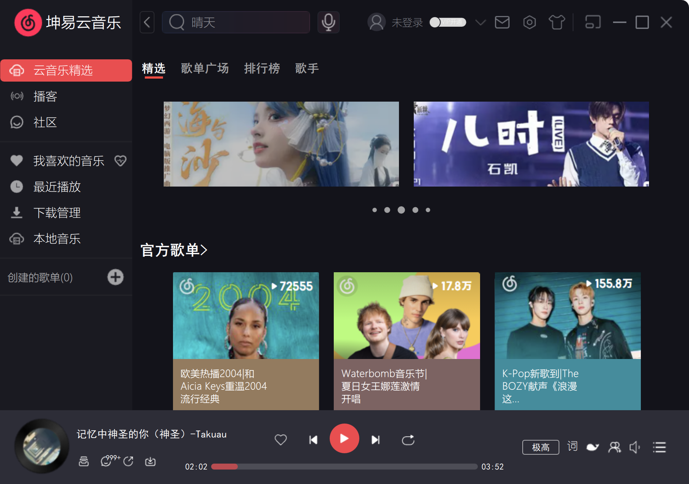
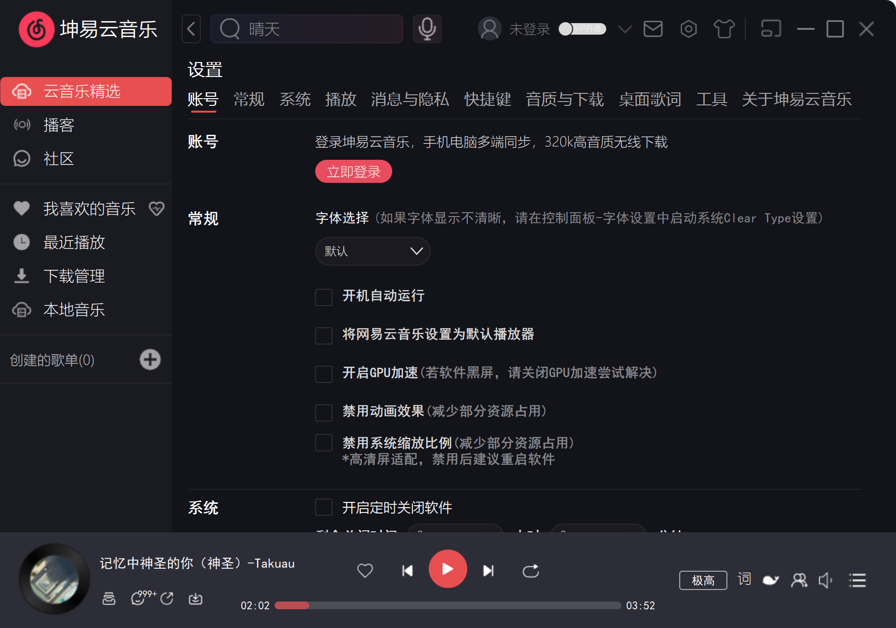
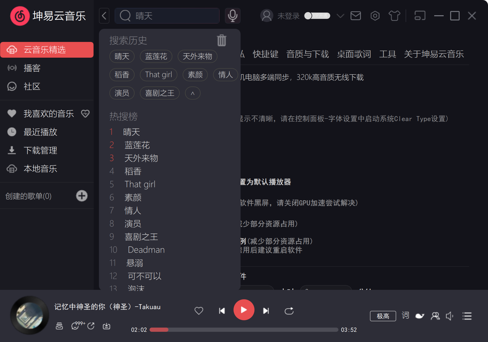
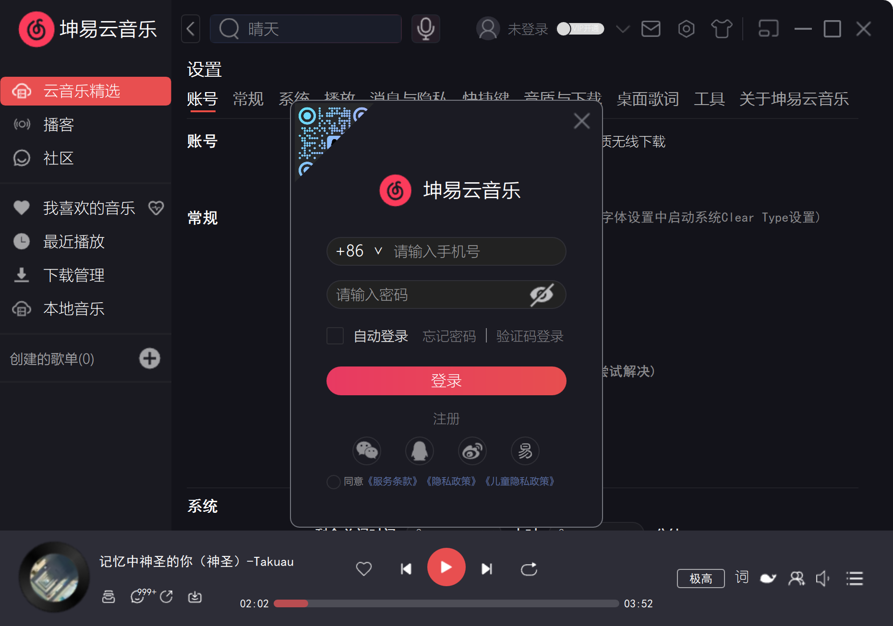
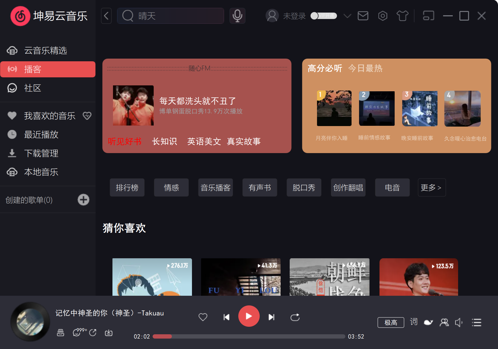

# 坤易云音乐桌面前端设计项目

## 项目介绍
坤易云音乐是一款基于Qt开发的桌面端音乐播放器前端应用，提供类似主流音乐平台的用户界面和核心功能。

## 项目背景
随着数字音乐的普及，用户对音乐播放器的需求日益增长，尤其是在桌面端拥有良好体验的音乐应用。坤易云音乐项目旨在通过Qt框架构建一个界面美观、功能完整的音乐播放器前端，为用户提供便捷的音乐播放和管理体验。项目参考了主流音乐平台的设计理念，同时充分利用Qt框架的跨平台特性和QML的界面开发优势，打造一个轻量化但功能强大的音乐播放解决方案。

## 技术栈

### 开发框架（开发环境）
- **Qt 5.15.2**：主要开发框架，提供跨平台应用程序开发支持
- **QML (Qt Meta Language)**：用于构建用户界面
- **C++**：核心逻辑实现
- **MSVC 2019**：编译器环境
- **Qt Quick Controls 2**：界面控件库
- **Qt Graphical Effects**：图形效果支持

### 核心版块（项目重要组成部分）
- **主界面模块**：包含左侧导航栏、右侧内容区域和底部播放控制栏
- **页面导航模块**：通过StackView实现页面间的切换和管理
- **音乐播放模块**：音乐播放控制和状态显示
- **用户交互模块**：包含登录弹窗、设置面板、换肤功能等
- **资源管理模块**：管理音乐、图片等资源文件

### 技术支持（相关技术栈）
- **QML组件系统**：自定义UI组件开发
- **信号与槽机制**：组件间通信
- **Qt Resource System**：资源文件管理
- **Qt Model/View**：数据展示
- **QSS样式表**：界面美化

## 项目功能

### 主界面功能
- **左侧导航栏**：提供云音乐精选、播客、社区等主要功能入口，以及我喜欢的音乐、最近播放、下载管理、本地音乐等个人音乐管理入口
- **右侧内容区**：根据导航选择展示不同内容，包括推荐音乐、歌手列表、排行榜、歌单广场等
- **顶部标题栏**：包含搜索框、用户登录入口、系统设置和窗口控制按钮

### 音乐播放功能
- **播放控制**：播放/暂停、上一曲/下一曲、音量调节
- **歌曲信息展示**：显示歌曲名称、歌手信息、评论数等
- **专辑封面显示**：支持专辑封面动画效果
- **音乐收藏与分享**：收藏喜欢的歌曲，支持评论和分享功能

### 用户交互功能
- **登录系统**：支持扫码登录和其他方式登录
- **主题切换**：支持自定义界面颜色和主题
- **系统设置**：定时关闭、关闭行为设置等
- **搜索功能**：搜索音乐、歌手、专辑等

### 内容展示功能
- **轮播图**：展示精选内容和活动
- **歌单推荐**：推荐热门歌单和个性化歌单
- **歌手列表**：展示热门歌手
- **排行榜**：展示各类音乐排行榜

## 项目应用方向

### 未来应用趋势
- **跨平台应用**：利用Qt的跨平台特性，扩展至macOS和Linux平台
- **在线音乐服务**：接入音乐API，提供在线音乐播放服务
- **个性化推荐**：基于用户行为分析，提供个性化音乐推荐
- **社交功能**：增强用户间互动和音乐分享功能

### 行业应用方向
- **桌面端音乐播放器**：作为独立的音乐播放应用
- **音乐内容平台前端**：为音乐内容提供商提供前端解决方案
- **企业内部音乐服务**：为企业内部提供定制化的音乐播放服务
- **教育与培训**：作为Qt/QML开发学习的案例和参考

## 使用说明

### 主要操作流程
1. **启动应用**：双击应用程序图标启动坤易云音乐
2. **浏览音乐**：通过左侧导航栏选择不同分类的音乐内容
3. **搜索音乐**：在顶部搜索框中输入关键词搜索音乐
4. **播放音乐**：点击音乐列表中的歌曲开始播放
5. **控制播放**：使用底部播放控制栏进行播放/暂停、上一曲/下一曲等操作
6. **登录账户**：点击顶部用户图标进行登录，可选择扫码登录或其他登录方式
7. **个人设置**：点击顶部设置图标进入设置界面，可进行主题切换、定时关闭等设置
8. **管理音乐**：通过左侧导航栏进入我喜欢的音乐、最近播放等页面管理个人音乐

